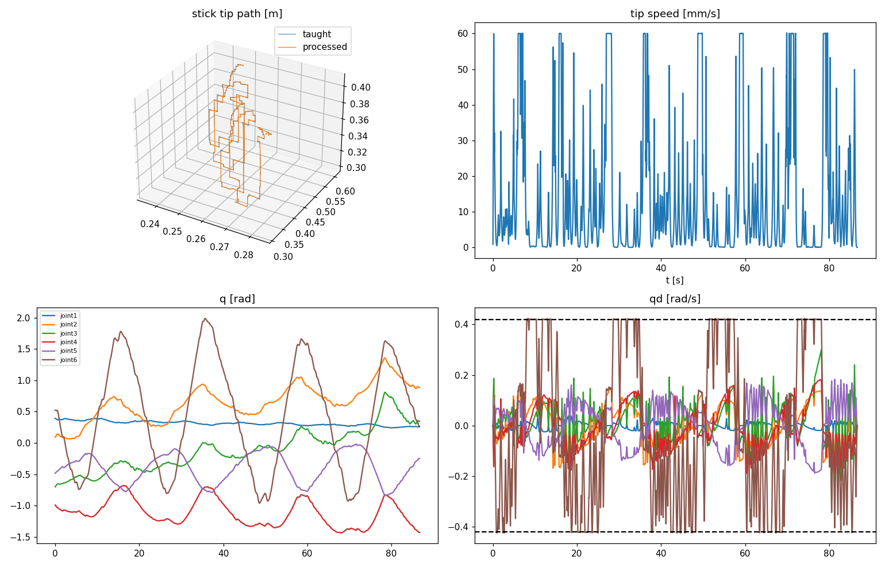

# Buzz Wire Challenge on the Addverb HEAL arm (Group 6)

The robot traces a twisted 3D wire with a loop on a stick, without touching the wire.
We teach the path once, process it into a smooth timed trajectory, and replay it with
damped least-squares inverse kinematics (DLS-IK) and joint velocity commands.

**Demo videos**

- Forward run (start to end of the wire): https://youtu.be/hoY5CwrO2DI
- Backward run (end to start): https://youtu.be/m1hTtmguCew

## Results

Produced by `python3 stage1/evaluate_runs.py` from the logs in `data/replays/`
(full table in `data/evaluation_summary.csv`).

| Run log | Direction | Trajectory | Run time | Max tip error | Touches marked |
|---|---|---|---|---|---|
| `replay_20261117_223942.csv` | forward | `traj_20261117_215345_fast3` | 63.7 s | 4.65 mm | 0 |
| `replay_rev_20261117_223732.csv` | backward | `traj_20261117_215345_fast3` | 62.6 s | 4.48 mm | 0 |
| `replay_20261117_221541.csv` | forward | `traj_20261117_215345_fast` | 97.4 s | 3.37 mm | 0 |
| `replay_rev_20261117_221203.csv` | backward, half speed | `traj_20261117_215345_fast` | 190.6 s | 1.63 mm | 0 |

- "Tip error" is the distance between the stick loop centre and the taught path, computed
  from the joint encoders. It is not a measured distance to the wire.
- "Touches" are wire contacts the operator marks with a key when the board's buzzer sounds
  (see [Evaluation](#7-evaluation)).
- Earlier runs with touches (16 and 32 marks on 16 Nov) are kept in the logs; they were made
  with a faster, more heavily smoothed trajectory and are why the final runs use gentler limits.

## Repository layout

```
stage1/teleop_teach.py     teach: keyboard jogging of the stick tip + recorder
stage1/process_teach.py    offline: clean, smooth and time the taught path
stage1/replay_dls.py       replay with DLS-IK velocity control, logs and touch marking
stage1/goto_pose.py        helper: move to the trajectory start/end pose (to re-grip the stick)
stage1/register_setup.py   helper: re-fit a taught path after the wire board was moved
stage1/evaluate_runs.py    evaluation: time, contact events and success rate from the logs
config/                    HEAL URDF used for kinematics (offline scripts read this copy)
data/                      teach recordings, processed trajectories, replay logs, touch logs
poses/                     joint state and tool pose at the wire start
provided_sample_code/      course-provided HEAL samples (velocity commands, DLS-IK, homing)
docs/                      example processing plot
```

## 1. Setup

| Item | Version used |
|---|---|
| Robot | Addverb HEAL, 6 joints (`joint1` ... `joint6`), gripper holding the stick |
| OS / ROS | Ubuntu 22.04, ROS 2 Humble, Python 3.10 |
| Robot driver | `heal_server` on the robot PC + `addverb_cobot_control` (`velocity_control.launch.py`) |
| ROS packages | `rclpy`, `sensor_msgs`, `geometry_msgs`, `std_msgs`, `python3-pykdl`, `kdl_parser_py`, `urdf_parser_py` |
| Python packages | `numpy`, `scipy`, `pandas`, `matplotlib`, `pygame` (`pip install -r requirements.txt`) |

ROS interfaces used by our code:

| Topic | Type | Use |
|---|---|---|
| `/joint_states` | `sensor_msgs/JointState` | joint feedback |
| `/velocity_controller/commands` | `std_msgs/Float64MultiArray` | 6 joint velocities, order `joint1..joint6` |
| `/robot_description` | `std_msgs/String` | URDF for the KDL chain (live teaching) |
| `/tool_end_effector_pose` | `geometry_msgs/PoseStamped` | cross-check of our forward kinematics |

The controlled point is the **stick loop centre**: link `rq_tool_tip` plus an offset of
95 mm along its z axis (`DEFAULT_TIP_OFFSET` in `stage1/teleop_teach.py`).

## 2. Starting the robot

Terminal 1 (robot PC):

```bash
ssh cobot@192.168.1.25
cd /home/cobot/addverb_images/gripper_fix_2026-09-08/
sudo env HOME=/home/cobot ./cobot run      # then type 1 and press ENTER
./heal_server                              # velocity-control server
```

Other programs in the same folder (run instead of `./heal_server`):

- `./free_drive` - gravity compensation mode, the arm can be moved by hand
- `./base_rigid` - go to the home pose

Terminal 2 (velocity controller, only while `./heal_server` is running):

```bash
cd Debojit_WS/addverb_ws/
source install/setup.bash
ros2 launch addverb_cobot_control velocity_control.launch.py
```

Terminal 3 (our scripts): source the same workspace, then `cd` into this repository.

## 3. Teaching phase

Our recorder needs `heal_server` and the velocity controller, so the path is taught by
**jogging the stick tip from the keyboard** (the motors move the arm through the same DLS-IK
used in replay) instead of pushing the arm by hand in `./free_drive`.
Fixed jog speeds give a recording without hand tremor.

```bash
python3 stage1/teleop_teach.py --selftest   # moves nothing: checks URDF, FK and Jacobian
python3 stage1/teleop_teach.py --dry-run    # window and keys, publishes nothing
python3 stage1/teleop_teach.py              # LIVE
```

Click the window so it has focus. The arm moves only while a key is held.

| Key | Action |
|---|---|
| W/S, A/D, R/F | move the tip along +x/-x, +y/-y, +z/-z |
| J/L, I/K, U/O | rotate about the stick tip (rx, ry, rz) |
| 1 / 2 / 3 | speed level: 5, 10, 20 mm/s |
| TAB | base frame / tool frame |
| SPACE | brake (hold) |
| ENTER | start / stop recording |
| P | mark a reference point on the wire |
| ESC | quit |

Procedure: jog the loop to the start of the wire, press ENTER, trace the wire keeping the
loop centred, press ENTER, then ESC. The recording is saved at 100 Hz as
`data/teach_<date>_<time>.csv` (joint angles, measured and commanded joint velocities,
tip pose) with a `.json` of the settings.

## 4. Processing

Offline, no robot needed:

```bash
python3 stage1/process_teach.py data/teach_20261117_215345.csv \
    --qd-max 0.42 --qdd-max 1.0 --v-max 0.06 --w-max 1.0 --name fast
```

Steps inside the script:

1. Drop duplicate samples and all rows where the arm did not move.
2. Re-parameterise by path length (position plus weighted rotation) and resample every 0.5 mm.
3. Gaussian smoothing in joint space. The largest smoothing that keeps the tip within
   `--tol-mm` / `--tol-deg` of the taught path is chosen automatically.
4. Time-scaling: the fastest speed profile that respects per-joint speed and acceleration,
   tip speed and tip angular speed, with zero velocity at both ends.
5. Sample at 100 Hz and save `data/processed/traj_<name>.npz` (+ `.csv`, `.json` summary, `.png` plot).

`--slow-near data/touches/<file>.csv` slows the trajectory around spots where touches were
marked in an earlier replay.

Limits of the two trajectories used for the final runs (from their `.json` files):

| Trajectory | Joint speed | Joint accel | Tip speed | Smoothing | Deviation from taught path | Duration |
|---|---|---|---|---|---|---|
| `traj_20261117_215345_fast` | 0.42 rad/s | 1.0 rad/s² | 0.06 m/s | 2 mm | 0.67 mm | 95.2 s |
| `traj_20261117_215345_fast3` | 0.44 rad/s | 1.5 rad/s² | 0.15 m/s | 6 mm | 1.87 mm | 60.0 s |



## 5. Replay phase

Close the teleop window first; replay refuses to start if another node publishes commands.

```bash
T=data/processed/traj_20261117_215345_fast3.npz
python3 stage1/replay_dls.py $T --sim        # no ROS: simulated run, expected time and error
python3 stage1/replay_dls.py $T --dry-run    # reads /joint_states, publishes nothing
python3 stage1/replay_dls.py $T --speed 0.5  # LIVE at half speed
python3 stage1/replay_dls.py $T              # LIVE at full speed
python3 stage1/replay_dls.py $T --reverse    # play end -> start
```

The live run waits for ENTER before moving. The robot must be within 0.08 rad of the
trajectory start (or end, with `--reverse`); otherwise the script refuses to run.

Keys during a live run: SPACE or T = mark a wire touch, P = pause/resume, Ctrl-C = stop.

Control law, 100 Hz:

```
V  = r * J(q_d) * qd_taught  +  [ Kp * (p_d - p) ; Kr * log(R_d * R^T) ]
qd = J^T (J J^T + lambda^2 I)^-1 V
```

- The first term is feedforward from the taught trajectory; the second is feedback on the
  tip pose error (`Kp = Kr = 3`). Feedforward removes the lag a pure error controller has.
- Damping `lambda` is zero while the smallest singular value of `J` is above 0.05 and rises
  to 0.08 near a singularity, so the IK is exact away from singularities.
- `r` is the progress rate: it drops when the tracking error passes the warning level
  (1.5 mm / 1.5 deg) and the run aborts at 6 mm / 5 deg.
- The command is capped per joint, rate-limited, and checked against the joint limits.

Other options: `--list-marks`, `--from-pct`, `--to-pct` (play part of the path),
`--qd-cap`, `--warn-mm`, `--abort-mm`.

Helpers:

```bash
python3 stage1/goto_pose.py $T --backoff 0.06 --dry-run   # plan a move to the start pose
python3 stage1/goto_pose.py $T                            # move to the exact start pose
python3 stage1/register_setup.py data/teach_<original>.csv data/teach_<new marks>.csv
```

## 6. Sample code for velocity commands

The course-provided samples are in `provided_sample_code/` (`Dual_Arm/sample_ik/heal_dls_ik.py`,
`Dual_Arm/homing_codes/heal_going_home.py`). The minimal pattern our scripts use:

```python
import rclpy
from rclpy.node import Node
from std_msgs.msg import Float64MultiArray

rclpy.init()
node = Node("velocity_example")
pub = node.create_publisher(Float64MultiArray, "/velocity_controller/commands", 10)

msg = Float64MultiArray()
msg.data = [0.0, 0.0, 0.0, 0.0, 0.0, 0.05]   # rad/s, order joint1..joint6
pub.publish(msg)                              # repeat at 100 Hz while moving

msg.data = [0.0] * 6                          # ALWAYS finish with zeros:
pub.publish(msg)                              # the driver keeps the last command
```

The driver rejects commands above 0.5 rad/s on any joint; our scripts stay at or below 0.45.

## 7. Evaluation

```bash
python3 stage1/evaluate_runs.py                  # all logs in data/replays/
python3 stage1/evaluate_runs.py --forward-only
```

For every replay it prints the run time, mean and maximum tracking error, the number of
marked touches and whether the run was a success (finished and no touch marked), followed
by the success rate and the fastest successful run.

Contact events: the wire board closes a buzzer circuit when the loop touches the wire.
The operator presses SPACE or T at the buzzer; `replay_dls.py` stores the path position,
joints, tip pose, tracking error and joint efforts in `data/touches/`. There is no automatic
contact sensor.

## 8. Safety checklist and emergency stop

Before every live run:

- [ ] Two people present: one at the keyboard, one with a hand on the E-stop.
- [ ] Workspace clear; nobody inside the arm's reach.
- [ ] Stick firmly held in the gripper; loop centred on the wire at the start.
- [ ] `--selftest` (teaching) or `--sim` and `--dry-run` (replay) passed.
- [ ] First run of a new trajectory at `--speed 0.5` or lower.

Stopping, in order of preference:

1. Teleop: release the keys (dead-man), or hold SPACE. Replay: press P to pause.
2. Ctrl-C in the script terminal: the script ramps down and publishes zero velocity.
3. **E-stop button** if the arm does anything unexpected. Afterwards restart `heal_server`
   and the velocity controller before running again.

Built-in protections:

- Teleop moves only while a key is held and stops if the window loses focus.
- All scripts stop if `/joint_states` is older than 0.1 s or is all zeros.
- In teleop and replay, a watchdog publishes zero velocity if the control loop stalls for 0.1 s.
- Per-joint speed cap, acceleration ramp and a joint-limit guard on every command.
- Replay slows down when tracking error grows and aborts beyond 6 mm / 5 deg.
- Zero velocity is published on every exit path.

## Stage 2

Not attempted. This repository covers Stage 1 only.

## Credits

`provided_sample_code/` is the course-provided material (MIT licence, see its `LICENSE`).
